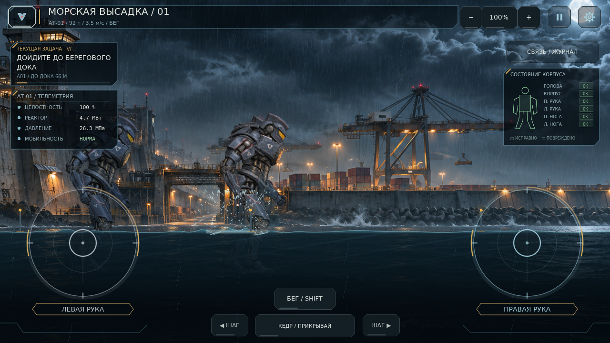
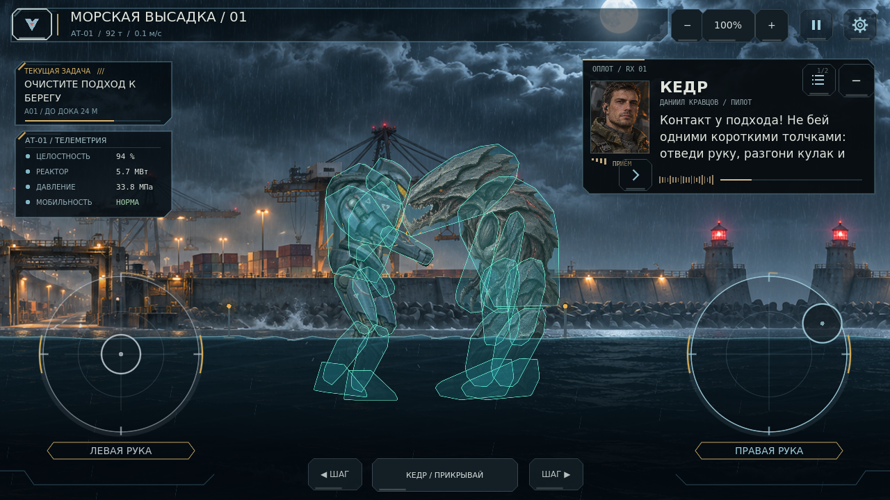
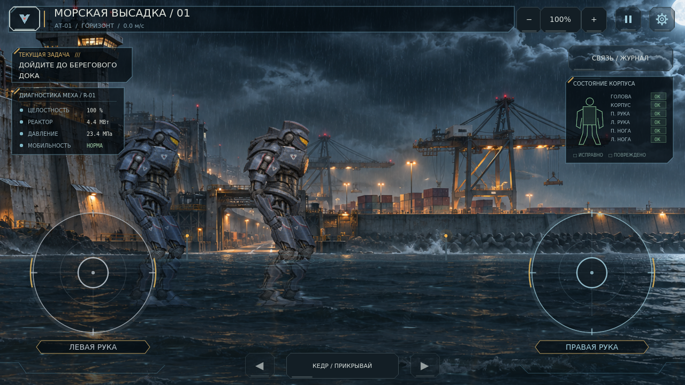

# RIFT: ZERO PROTOCOL — 0.13.0 «Ударная масса»

Полный исходный проект для **Godot 4.7.2**, Android и настольного тестирования. Главная сцена — `scenes/boot/boot.tscn`. Это самостоятельная сборка: накладывать старые патчи не нужно.

[Скачать проект ZIP](https://github.com/stasaleksandrov481-netizen/ZERO-PROTOCOL/archive/refs/heads/main.zip)



## Новое в 0.13.0

Руки сгибаются и ведут кулак по плавной траектории: отвод назад, прямой удар, удар снизу и удар вниз. Плечо и локоть работают вместе; после контакта локоть немного поддаётся нагрузке. Ограничители и торможение после отпускания сохранены.

Сильное попадание физически отталкивает машину: корпус отклоняется, ноги делают шаг для восстановления опоры. И игрок, и Клык могут потерять равновесие, упасть и подняться с земли. Обычная ходьба стала шире; тяжёлый бег даёт больший шаг при чуть более медленной работе ног.

Клык преследует, предупреждает о рывке, разгоняется, наносит выпады и уклоняется от приближающегося кулака. Исправлена слишком большая дистанция замаха. После оглушения есть время на ответную атаку. Запас брони и обработка повторных контактов рассчитаны на **бой не короче 40 секунд**; контрольная победа настоящими ударами заняла **54.5 секунды**.

Плеск усилен до 90 капель на обычный шаг и 156 на сильное приземление; добавлены боковые водяные веера и плотная пена. HUD показывает состояние равновесия, намерение и целостность врага. Новая кнопка «БЕГ / ВСТАТЬ» работает отдельным пальцем, пока обе руки заняты стиками.

[Изменения, проверка и ограничения 0.13.0](docs/UPDATE_0_13_0.md).

## Новое в 0.12.0

Исправлено непрерывное вращение рук после круговых движений стиком. Целевые углы ограничены, при отпускании команды привод тормозит и возвращает руку в покой; потеря фокуса сбрасывает захваченные стики.

Коллизии пересобраны по силуэтам актуальных атласов: 12 форм АТ-01 и 10 форм Клыка, включая выступающую голову и движущиеся конечности. Убраны общий прямоугольник врага и завышенные круги кулаков. Вражеский удар требует реального контакта, а не только близости персонажей.

Вода теперь — плоский боковой 2D-срез, с волнами вдоль линии поверхности. Перспективные круги и экранное преломление удалены. Плеск шире и выше, возникает у реально опустившейся ноги; эффекты двух машин не подавляют друг друга. Масса АТ-01 осталась 92 т: ходьба постепенно разгоняется и тормозит, шаг сопровождается низким механическим ударом и небольшой затухающей реакцией камеры.

В HUD видны масса и расстояние до дока; кнопки ходьбы подписаны. Активный радиоканал находится справа, освобождая головы бойцов. На телефоне диагностика компактнее, прозрачные стики меньше перекрывают воду и ноги.

[Изменения, проверка и ограничения 0.12.0](docs/UPDATE_0_12_0.md).



## Новое в 0.11.0

Пролог теперь поставлен как ночной перелёт к ДОК-17: море, дождь, два транспорта, плавное приближение, портреты экипажа, короткие реплики и собственный звук винтов. Ваш выбор сразу получает ответ персонажа. Дальше вы переходите сами; перед высадкой появляется сводка задачи, группы и первых действий.

Доступны мгновенный текст, клавиши 1 / 2, пробел для раскрытия реплики и возврат к выбору. После подписи можно перейти прямо к сводке: важные факты останутся в журнале, невыбранные ответы не подставляются. Подписанный допуск и сводка предшествуют запуску новой кампании; до запуска существующий прогресс сохраняется.

В игре появились необязательные подсказки, которые отслеживают проверку рук и первые шаги, индикатор пути к доку, плавное обновление задачи, вкладки журнала и памятка управления в паузе. Звук конвоя продолжается в высадке и останавливается вместе с ней при паузе. Уточнены названия АТ-01 «Оплот»; архив больше не раскрывает причину инцидента заранее.

[Изменения, проверка и ограничения 0.11.0](docs/UPDATE_0_11_0.md).



## Исправление 0.10.1

Устранён сбой `klyk_2d.gd:30`: исходные PNG читаются напрямую, даже если подготовленный кэш импорта отсутствует или остался от другого устройства. Старый атлас, старое изображение робота в меню и прежний 3D-рендерер удалены. Меню, ангар, каталог, полигон и кампания используют актуальный атлас из семи деталей. Игровая сцена скрыта до завершения проверки запуска.

[Подробности исправления и проверки](docs/PATCH_0_10_1.md). Распакуйте новую сборку в отдельную папку и откройте её `project.godot`. Формат сохранений не изменился.

## Запуск

1. Распакуйте весь архив в отдельную папку.
2. Импортируйте `project.godot` в Godot **4.7.2** и дождитесь импорта ресурсов.
3. Запустите проект: **Кампания → Новая игра**.
4. Введите имя и фамилию, нарисуйте подпись на электронном соглашении, пройдите короткий инструктаж.
5. После высадки дойдите до дока. На карте выбирайте любую доступную соседнюю базу; можно возвращаться по тем же связям.

Старые сохранения 0.9 автоматически переходят в новую схему маршрутов. Чтобы увидеть новое вступление, начните новую игру. Старый прогресс заменяется после оформления допуска и инструктажа; предыдущая запись сохраняется резервной копией.

## Управление

| Действие | Android | ПК |
|---|---|---|
| Левая / правая рука | Два независимых стика | ЛКМ / ПКМ либо стики мышью |
| Шаг | Двойное касание с удержанием свободной стороны или стрелки | A / D |
| Тяжёлый бег | Включить «БЕГ», затем удерживать шаг | Shift + A / D или кнопка «БЕГ» |
| Подъём после падения | «ВСТАТЬ»; затем автоматическое восстановление | R; затем автоматическое восстановление |
| Альтернативное движение | Наклон телефона, включается в настройках | — |
| Масштаб камеры | Два свободных пальца или кнопки − / + | Колесо или кнопки − / + |
| Стыковка | Контекстная кнопка рядом с доком | Та же кнопка |
| Приказ Кедру | Кнопка группового канала внизу | Та же кнопка |
| Пауза / настройки | Верхние кнопки | Верхние кнопки / Esc |

## Содержание версии

- HUD по приложенному образцу: тонкие холодные рамки, янтарные детали, диагностика слева, схема корпуса справа, крупные прозрачные стики.
- Новая кампания: личное дело, цифровой договор без бумажного листа, настоящая рисованная подпись и пять диалоговых этапов с ответами.
- Пилот — участник программы «Оплот», позывной «Первый». Даниил Кравцов / «Кедр» выходит на своей отдельной физической машине.
- Высадка с двух тяжёлых транспортных вертолётов на ночную морскую отмель.
- Вода до колен: плоский 2D-срез с анимированной линией поверхности, расходящимися волнами, крупным плеском от ног и звуком тяжёлых шагов.
- Первая треть карты: **11 баз и 17 двусторонних связей** в шахматном расположении. Два следующих региона целиком закрыты туманом и недоступны.
- Три типа ночных маршрутов: море, городской док, мост. Все пути используют эти три типа окружения.
- Физические удары, самостоятельный напарник, бой до победы, стыковка, однократные награды и сохранение выбранного пути.
- Камера учитывает высоту экрана. Фон продолжен за обоими концами уровня при любом доступном масштабе.

## Проверка и границы

Проверены настоящий запуск в Godot 4.7.2, новая игра, свободная подпись, переходы между базами, физические попадания и победа, сохранение, пауза, настройки, кадры 1280×720 и 1024×459. Детали — [проверка 0.13.0](docs/UPDATE_0_13_0.md), [проверка 0.12.0](docs/UPDATE_0_12_0.md), [проверка 0.11.0](docs/UPDATE_0_11_0.md), [предыдущая проверка](docs/VALIDATION_0_10_0.md) и [сверка с исходным запросом](docs/REQUEST_CHECKLIST_0_10_0.md).

Пока это игровой срез первого региона. Полная драматургия главы, уникальные события каждой из 17 дорог, живые интерьеры всех баз и главы II–III в этом обновлении не реализованы. Улицы, морские подходы и мосты используют повторяемые панорамные слои. HUD воспроизводит компоновку и оформление референса; это не попиксельная копия всей иллюстрации. APK и физический Android-телефон в этой среде не проверялись.

## Разработка

Основной репозиторий: **stasaleksandrov481-netizen/ZERO-PROTOCOL**. Следующие запрошенные обновления публикуются сюда.

Проверки текущей версии:

```bash
godot --headless --editor --path . --import
godot --path . res://tests/nightfall_tests.tscn
godot --path . res://tests/asset_startup_tests.tscn
godot --path . res://tests/prologue_tests.tscn
godot --path . res://tests/physics_regression_tests.tscn
godot --path . res://tests/dynamic_combat_tests.tscn
```

Для тестов используйте отдельный каталог пользовательских данных. Тестовый сценарий создаёт кампанию и намеренно проходит маршруты. `tests/capture_polish_10.tscn` снимает экраны, оба конца уровня и телефонный размер. Путь для кадров можно задать переменной `RIFT_CAPTURE_DIR`; по умолчанию используется `user://qa/nightfall/`.

`tests/capture_prologue.tscn` снимает пять сцен, ответы и сводку, размеры 1280×720, 1024×459 и 800×450, подсказку, журнал и паузу. Исторические тесты предыдущих прототипов оставлены для справки; текущие сценарии перечислены выше.

`tests/capture_weight.tscn` снимает обычную воду, шаг с плеском, телефонный HUD, контакт, реальные контуры коллизий и руки после отпускания. Контуры включены только в диагностическом кадре.

`tests/capture_dynamic.tscn` снимает длинный шаг, усиленный плеск, три направления кулака, восстановительный шаг, падение, подъём, рывок Клыка и компактный боевой HUD. Эти диагностические кадры используют заданные импульсы; победу реальными ударами отдельно проверяет `nightfall_tests.tscn`.
