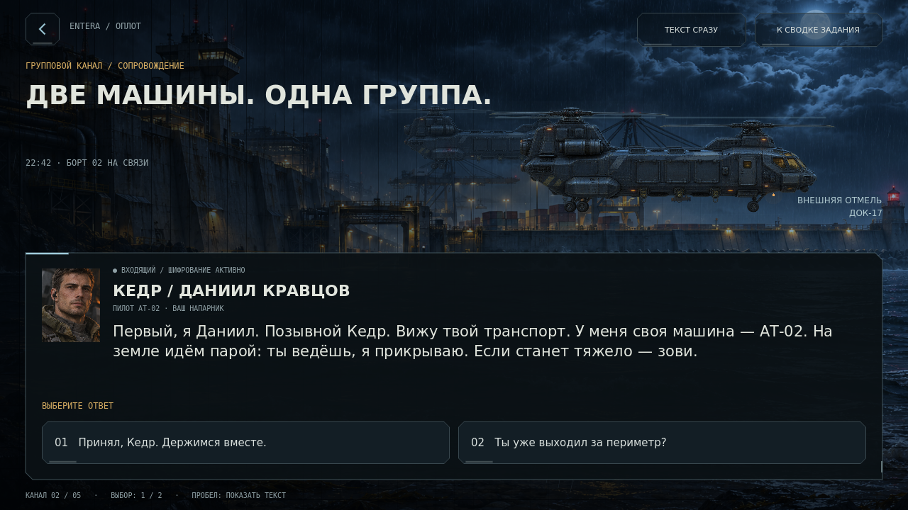
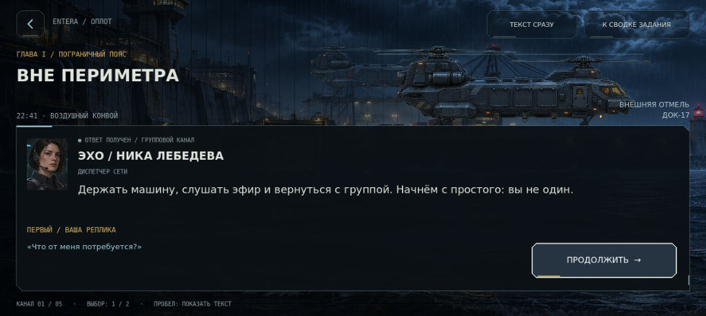
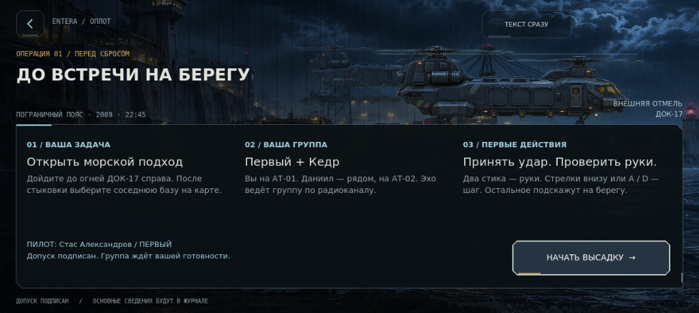
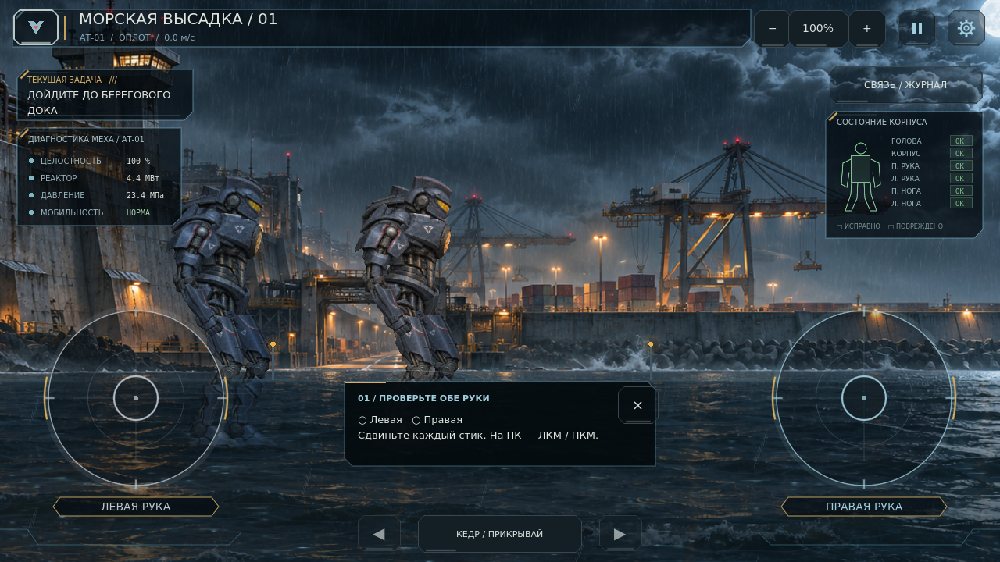
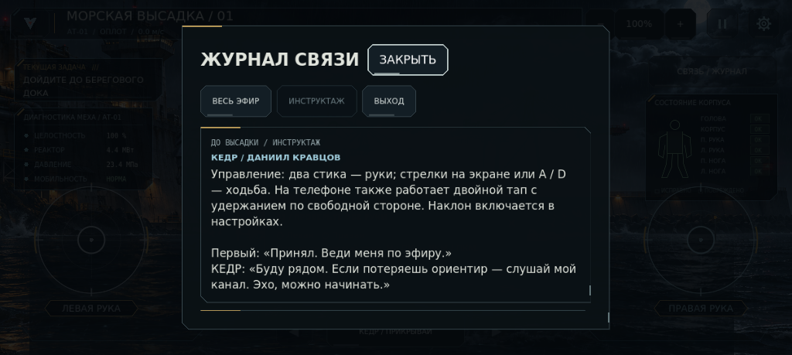

# 0.11.0 — Ночной конвой

Обновление визуальной подачи пролога и первого выхода. Основано на текущем игровом срезе 0.10.1 и просьбе автора сделать вступление и игру красивее, затем ещё раз пройтись по результату. Начальная высадка в море сохранена согласно последнему авторскому решению.

## Что изменилось

| Область | Результат |
|---|---|
| Постановка пролога | Ночной берег, два транспорта в боковой перспективе, дождь, слабый свет прожекторов, плавное приближение к точке сброса. Живой фон остаётся позади читаемого текстового блока. |
| Разговор | Пять коротких сцен с портретами Ники, Даниила и Ветровой. Выбор немедленно показывает ответ персонажа; следующая сцена открывается по нажатию. Можно вернуться и изменить ответ. |
| Темп и доступность | Кнопка раскрытия текста, мгновенный показ, клавиши 1 / 2 и пробел. В режиме уменьшенного движения фон статичен, текст открыт целиком, смена реплик без анимации. |
| Готовность к миссии | После разговора — сводка задачи, группы и управления с именем пилота и отдельной кнопкой высадки. Пропуск после подписи ведёт к этой же сводке. Старая кампания сохраняется до начала высадки. |
| Журнал | Пять записей с важными фактами и только реально выбранными ответами. Вкладки «Весь эфир», «Инструктаж», «Выход»; свежие записи выше, у полевого эфира есть время. |
| Первые действия | Неблокирующая подсказка отмечает движения каждой руки, затем первые шаги. Можно закрыть. Выполненная проверка сохраняется; подсказка не задерживает бой или маршрут. |
| Полевой интерфейс | Тонкий индикатор пути к доку, мягкая смена текущей задачи, памятка управления в паузе. |
| Звук | Оригинальная зацикленная подложка роторов и ветра через SFX. Продолжается в морской высадке, затихает при уходе транспорта, останавливается при паузе и сворачивании приложения. |
| Последовательность мира | АТ-01 называется «Оплот» в личном деле, ангаре и HUD. Начальная архивная сводка оставляет причину инцидента на «Горизонте» неизвестной. |

Реплики и факты журнала берутся из одного `prologue_script.gd`, чтобы информация после пропуска не расходилась с прологом. Формат сохранения остался схемой 1; добавлены сведения в существующие поля flags и radio. Старые кампании не перезаписываются автоматически. Чтобы увидеть новый пролог, выберите новую игру.

## Проверка

Godot 4.7.2 stable, Linux, отдельные пользовательские каталоги:

| Набор | Результат | Что проверяет |
|---|---:|---|
| `nightfall_tests.tscn` | 67 / 67 | Регистрация и подпись, сводка, морская высадка, две машины, физическая победа, маршруты в обе стороны, награды без повторов, сохранения, пауза и настройки. |
| `asset_startup_tests.tscn` | 33 / 33 | Загрузка PNG без зависимости от старого импорта, отсутствие прежних моделей, единая текущая модель в меню и игре, скрытие незавершённых сцен. |
| `prologue_tests.tscn` | 42 / 42 | Ветки и возврат, клавиатура, мгновенный текст, уменьшенное движение, 4 компоновки, сохранение журнала, фильтры, пропуск, аудиопереход и пауза высадки, реальные действия обучения. |

Всего **142 проверки**, неожиданных ошибок движка и скриптов нет. Отдельно скопирован только распространяемый исходный проект без `.godot`: импорт успешен, все 42 проверки пролога повторно прошли. Это проверка самостоятельности исходников, а не запуск поверх старой установленной версии.

Сняты и просмотрены настоящие кадры в размерах 1280×720, 1024×459 и 800×450; поведенческая компоновка также проверена при 1600×900 и масштабе UI 1.25. Проверены вопросы, ответы, персональная сводка, подсказка, журнал и пауза. При визуальном проходе исправлены перекрытие содержимого фоновой панелью, неверная высота скрытой сводки и подпись точки сброса у края панели.

Экспорт Android PCK собран. Изолированный запуск пакета из пустой папки проверяет четыре критические текстуры, портреты и звук пролога, выбор и немедленный ответ, запуск экспедиции и записи журнала. Исходная папка проекта этому запуску не доступна. В PCK загружаются импортированные remap-текстуры через предусмотренный запасной путь; исходные PNG поставляются в ZIP проекта. Старый атлас и тестовые сцены в пакет не включены.

## Что пока не проверено и не добавлено

Физический Android и APK не проверялись: в этой среде нет Android build-tools. Проверка PCK подтверждает упаковку ресурсов и запуск сцен, но не аппаратную работу телефона. Звуковая логика проверена с Dummy audio driver; баланс громкости на динамиках телефона требует прослушивания на устройстве.

Это полировка существующего среза региона I. Уникальные миссии всех дорог, живые интерьеры всех баз, полная глава и главы II–III этим обновлением не добавлены. Постановка пролога использует панорамный фон и два транспорта; это не новая полностью трёхмерная кат-сцена. Доступные сцены и физика по-прежнему строго сбоку в 2.5D.

## Кадры

