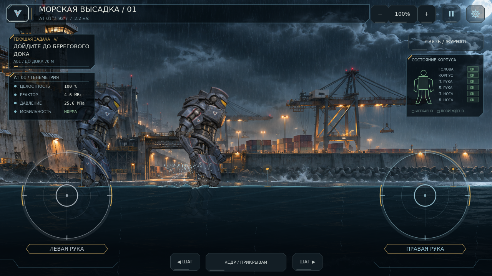
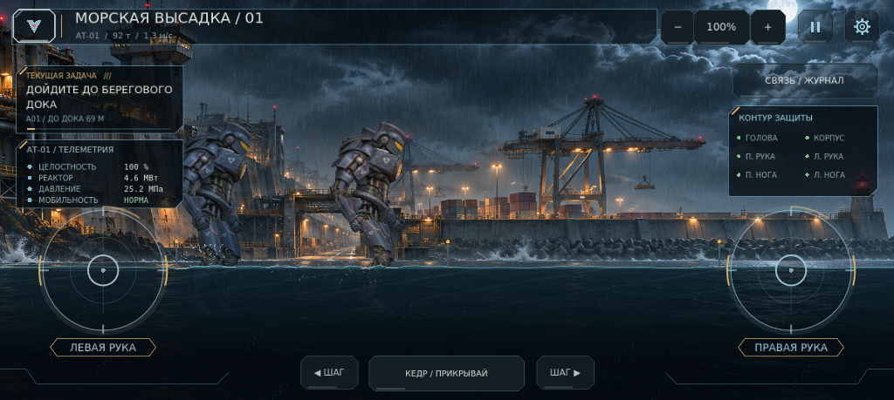
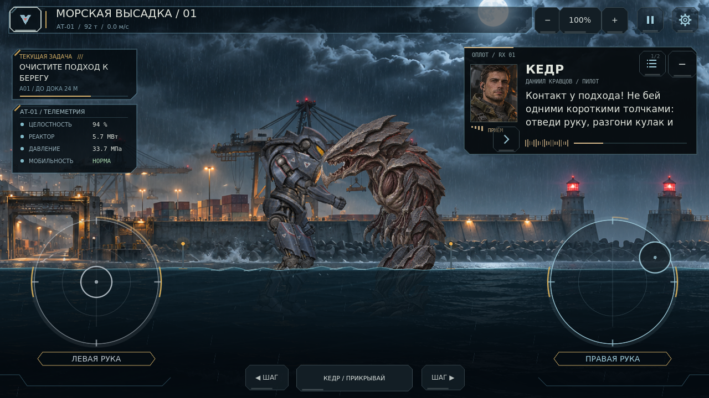
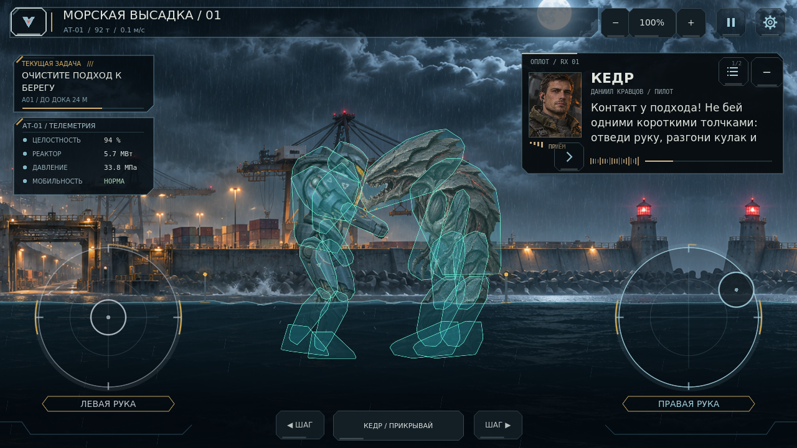

# 0.12.0 — Тяжёлый прилив

Исправление вращения рук, переработка столкновений, плоская 2D-вода и дополнительный проход по игровому HUD.

## Руки: воспроизведение и исправление

На 0.11.0 повторены четыре круговых движения стиком с последующим отпусканием. Целевой угол плеча накопился до −12.58 радиана, а угловая скорость плеча и предплечья удерживалась около −7 рад/с спустя пять секунд после отпускания. Одновременно проверочная точка на выступающей челюсти Клыка оставалась вне единственного прямоугольника столкновения.

В 0.12.0 целевой и измеренный углы находятся в одной ограниченной системе. Плечо имеет пределы −3.02…1.65 рад; локоть сохраняет ограничение сгибания. Отпускание отменяет накопленную командную скорость, после чего привод тормозит и возвращается к позе покоя. Потеря фокуса освобождает палец и мышь стика. Скорость и ускорение команды ограничены; конечности сохраняют инерцию.

В том же сценарии после отпускания скорость плеча и предплечья снижается примерно до 0.0008 и 0.0005 рад/с. Оба направления круговых движений и обе руки покрыты новой регрессией. Проверены также механические ограничители при ударе по обесточенному ригу и восстановление стойки после сброса.

## Коллизии

| Объект | Изменение |
|---|---|
| АТ-01 | Все 12 физических частей используют выпуклые контуры непрозрачной брони текущего атласа. Дополнительные завышенные круги кулаков удалены. |
| Клык | Вместо общего прямоугольника — 10 форм: корпус, голова с выступающей челюстью, ноги и руки. Позиции и повороты форм конечностей следуют за той же веткой, что и графика. |
| Контакт | Быстрый физический кулак с CCD упирается в челюсть. Сигнал попадания использует точку реального контакта. |
| Атака врага | Имеет замах и активное окно; урон требует контакта головы или когтей с корпусом/кабиной Атланта. Одной дистанции между центрами тел недостаточно. |

Формы измерены по актуальным PNG и упрощены до небольших выпуклых многоугольников. Это аппроксимация силуэта; мелкие отверстия между зубами и пальцами не моделируются отдельными физическими полостями. Маски соседних частей Атланта сохраняют защиту от зацепления собственных конечностей. Кедр остаётся отдельной машиной и не добивает противника вместо игрока.

## Вода и масса

Вода — боковой 2D-срез. Экранное преломление, перспективные овальные кольца и уходящие вниз дорожки отражений удалены. Линия поверхности колеблется; от шага в обе стороны расходятся волны и пена. Погружённые части видны сквозь плоскую окрашенную толщу воды.

Плеск привязан к реально опустившейся ноге. Обычный шаг создаёт 46 капель, сильное приземление — 84; на низком качестве число снижено. Капли вылетают шире и выше, чем прежде. Две машины могут плеснуть в разных местах одного кадра. Ограничения — 320 капель и 16 поверхностных возмущений; длина карты не увеличивает объём эффектов.

Масса рига — прежние 92 т. Доработаны разгон, торможение, частота шага и демпфирование приводов. Опорный шаг включает низкий синтезированный механический звук и короткий затухающий отклик камеры. Режим уменьшенного движения убирает отклик камеры; пауза останавливает физику и воду. Баланс звука на физических динамиках телефона пока требует прослушивания.

## Визуальный проход

Сняты и просмотрены настоящие кадры моря, шага с плеском, ближнего контакта, рук после отпускания, телефонного HUD, города и моста. Проверены оба конца морского уровня при масштабах 0.45 / 0.62 / 1.12. В сценарии захвата исправлено размещение физических тел: перенос выполняется через их запрос сброса в физическом шаге.

Исправления по снимкам:

- Рация перенесена вправо и временно занимает место правой диагностики, освобождая головы бойцов.
- Реплики разбиваются по измеренной высоте текста. Текст не заходит на нижний индикатор; слова и полная запись журнала сохраняются. Номер страницы отделён от кнопки журнала.
- В верхней строке видны масса и скорость, у задачи — расстояние до дока. Кнопки ходьбы подписаны «ШАГ».
- На низком экране справа показана компактная сводка; стики прозрачнее в покое.
- Быстрые переходы с уменьшенным движением больше не пытаются передать фокус уже закрытому экрану.

## Проверки

Godot 4.7.2 stable, отдельные пользовательские каталоги:

| Набор | Результат |
|---|---:|
| `nightfall_tests.tscn` — кампания, подпись, физическая победа, маршруты и сохранения | 67 / 67 |
| `asset_startup_tests.tscn` — изображения, отсутствие прежних моделей и скрытая сборка сцен | 33 / 33 |
| `prologue_tests.tscn` — вступление, выборы, сводка, журнал и первые действия | 42 / 42 |
| `physics_regression_tests.tscn` — приводы, столкновения, масса, вода, пауза и телефонный HUD | 35 / 35 |

Итого **177 проверок**, неожиданных ошибок скриптов и движка нет. Отдельный проект скопирован без `.godot`, заново импортирован; все 35 новых проверок повторно прошли.

Бой проверяется настоящими перемещениями, замахами стика и контактами, без прямого вызова урона. Телепортирование внутрь врага заменено подходом с безопасной дистанции. Победа открывает стыковку; сохранены однократные награды и обратные маршруты.

Экспорт Android PCK проверяется из пустой исходной папки: актуальные текстуры, пролог, составная коллизия Клыка, 2D-шейдер воды и экспедиция. PCK использует импортированные текстуры; исходные PNG поставляются в ZIP проекта.

Физический Android и APK в этой среде не проверялись. Субъективное ощущение массы и громкость на конкретном телефоне требуют игрового прогона на устройстве. Формат сохранений остаётся схемой 1; для этих исправлений начинать новую кампанию не требуется. Полная глава, новые регионы и новые сюжетные миссии этим обновлением не добавлены.

## Реальные кадры

