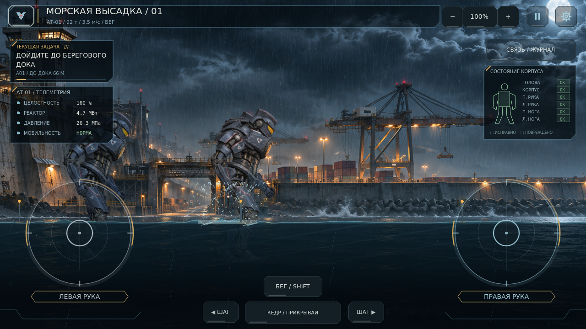
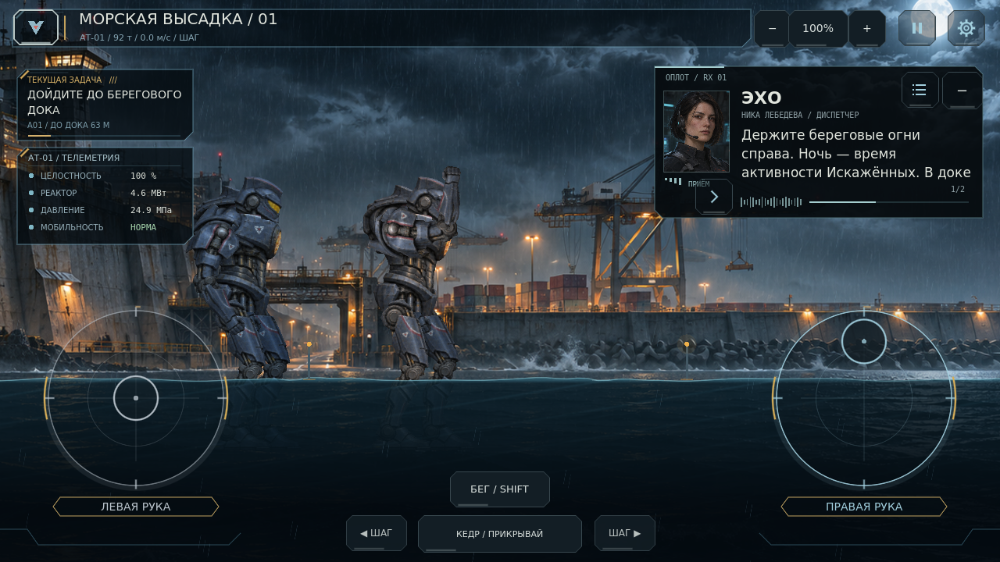
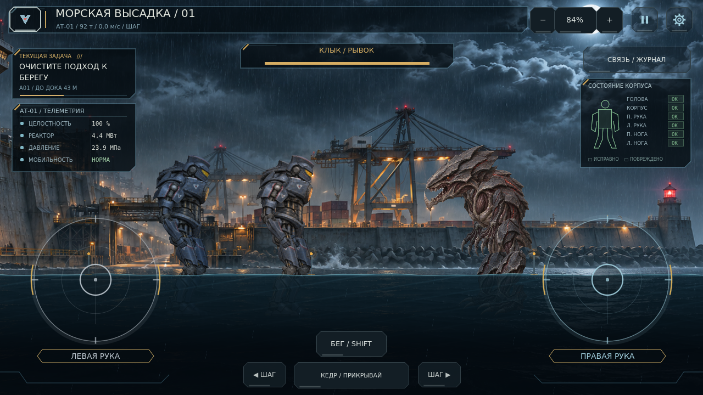
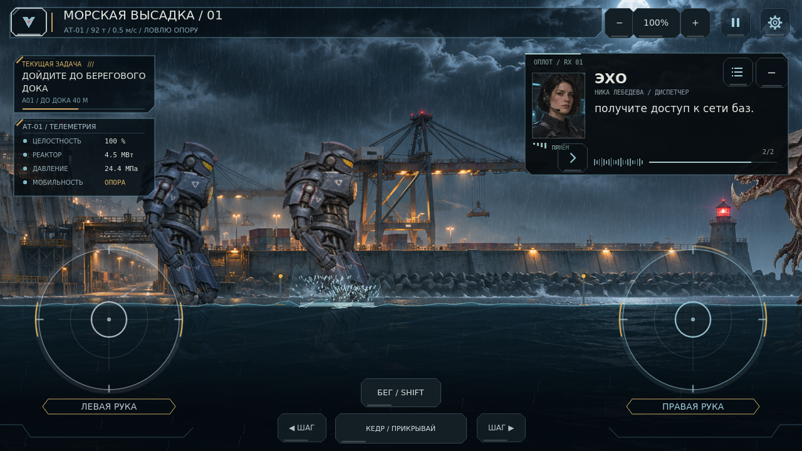
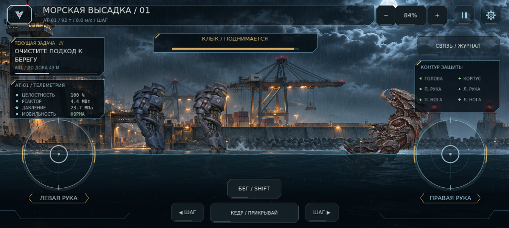

# 0.13.0 — Ударная масса

Обновление рук, равновесия, поведения Клыка, тяжёлого бега, длительности боя и воды. Формат сохранений остаётся схемой 1; начинать кампанию заново для этих исправлений не нужно.

## Руки и шаг

Положение стика задаёт точку для кулака в рабочей области перед машиной. Отвод назад складывает руку, движение вперёд раскрывает её в прямой удар; верх и низ дают разные вертикальные траектории. Сначала плавно движется целевая точка, затем ограниченные по скорости приводы плеча и локтя ведут физические части. Локоть немного поддаётся контактной нагрузке. Полные обороты не накапливаются, а отпускание по-прежнему тормозит руку.

В проверке положения конца предплечья относительно корпуса вертикальная разница прямого и верхнего удара составила около 196 пикселей; нижний оказался примерно на 30 пикселей ниже прямого и ближе к корпусу. Это реальные позы рига, а не смена картинки. Отдельные пальцы управляют обеими руками независимо.

Длина обычного шага увеличена. Бег постепенно удлиняет шаг и наклоняет корпус вперёд, не ускоряя мельтешение ног. В одинаковом пятисекундном прогоне машина прошла 612 пикселей шагом и 896 бегом — примерно на 46% дальше. Изменение фазы ног за тот же интервал: 13.71 и 13.08 радиана соответственно. Масса АТ-01 — прежние 92 т.

| Действие | Телефон | ПК |
|---|---|---|
| Бег | Включить «БЕГ» и удерживать движение | Shift + A / D либо кнопка «БЕГ» |
| Удар | Отвести стик, затем вынести вперёд / вверх / вниз | Те же стики либо физическое наведение кулака мышью |
| Начать подъём с земли | «ВСТАТЬ» | R |

Подъём также начинается автоматически после короткой паузы на земле. Пауза, потеря фокуса и выход из сцены снимают бег. Третий палец на его кнопке не забирает пальцы, уже управляющие руками. Кедр тоже умеет догонять бегом.

## Удар, равновесие и падение

Игрок и враг используют общую последовательность: устойчивость → потеря опоры → восстановительный шаг либо падение → земля → подъём. Удар даёт настоящий линейный и угловой импульс, корпус отклоняется в его сторону, ноги ищут новую опору. Сильный одиночный удар может опрокинуть машину; накопленная потеря равновесия повышает риск. Это шанс с учётом силы и состояния опоры, а не падение от любого касания.

На земле приводы ослаблены, при подъёме постепенно возвращают поддержку и устойчивость. Проверены большой физический угол падения, контакт с землёй и возвращение к стойке без сброса трансформаций. Слабые повторные касания не перезапускают один и тот же период оглушения бесконечно. После восстановления есть короткая защита опоры; урон и физический импульс продолжают работать. Подготовленная атака выдерживает среднее касание, но сильный удар способен её сорвать.

Клык преследует цель, подбирает дистанцию, делает короткий и тяжёлый выпады, предупреждает о рывке и разгоняется. Он замечает действительно приближающееся предплечье с задержкой, уклоняется с ограниченным временем и кулдауном. Упавшего игрока обходит на дистанции, позволяя подняться. Исправлена остановка слишком далеко от игрока: раньше замах заканчивался в воздухе. Новый тест подтвердил два настоящих контактных попадания за девять секунд по неподвижному защитнику.

Это конечный автомат с физическим восприятием, а не обучаемый ИИ. Направление текущей боковой графики сохранено; полноценных новых ракурсов атласа этим обновлением не добавлено.

## Не меньше сорока секунд

У Клыка 540 единиц целостности. Начальный доступный расход брони — 12 единиц, восстановление бюджета разрушения — 12.5 единицы в секунду. Этот общий бюджет не даёт множественным контактам двух кулаков и напарника удалить врага за секунды. Контакты сразу наносят доступный урон и сохраняют физическую реакцию; отдельного таймера неуязвимости нет. Сила попадания влияет на урон, отталкивание и потерю опоры; защита врага ослабляет урон.

Даже непрерывный предельный поток попаданий исчерпал броню в проверке за **42.25 секунды**. Полный бой настоящими движениями, стиками и столкновениями завершился через **54.5 секунды**. Игрок получил ответное попадание и сохранил 94.72% целостности. В этом сценарии урон напрямую не вызывался. Время обычной игры зависит от точности, движения, блокирования и Кедра и может оказаться больше. Напарник оставляет минимум 8 единиц целостности, чтобы завершающий удар принадлежал игроку.

## Вода и HUD

Обычный шаг создаёт 90 капель, сильное приземление — 156. Усилены высота, ширина и время плеска, поверхностная волна; добавлены прозрачные боковые веера вытесненной воды, крупные капли и плотная пена. Работают ноги обеих машин и Клыка. Вода остаётся строго плоским боковым 2D-срезом, без перспективных колец и экранного преломления. Бюджеты фиксированы: 500 капель и 16 волн, низкое качество уменьшает число частиц.

Верхний индикатор показывает целостность врага и читаемый замах, рывок, уклонение или подъём. Слева видны состояние опоры, масса и скорость машины. Кнопка бега становится кнопкой подъёма; исчезает при контекстном взаимодействии. По реальным кадрам проверено размещение боевой полосы между задачей и правой рацией, отдельные элементы на 1280×720 и 1024×459, а также три направления удара и позы падения/подъёма. Новые графические исходники не требуются.

## Проверки

Godot 4.7.2 stable, отдельные пользовательские каталоги:

| Набор | Результат |
|---|---:|
| Кампания, подпись, настоящий бой, маршруты и сохранения | 68 / 68 |
| Загрузка ресурсов и отсутствие старых моделей | 33 / 33 |
| Пролог, ответы, сводка и журнал | 42 / 42 |
| Приводы, коллизии, вода, масса и пауза | 35 / 35 |
| Новая динамика, ИИ, длительность и мобильное управление | 25 / 25 |

Итого **203 проверки**, неожиданных ошибок скриптов и движка нет. Дополнительно выполнен чистый импорт проекта без `.godot`; все 25 проверок новой динамики повторно прошли в этой копии. Android PCK экспортирован и запущен из пустой папки исходников: актуальные текстуры, пролог, составные коллизии, системы баланса/брони, кнопка бега и экспедиция готовы, ошибок нет. Исходные PNG доступны в ZIP проекта; пакет использует импортированные текстуры.

Физический телефон и APK здесь не проверялись. Снимки получены из настоящего Godot viewport с программным графическим драйвером; они не измеряют FPS, нагрев или задержку реального Android. Диагностические падения на снимках вызываются заданными физическими ударами, а не выдаются за прохождение боя. Новые регионы, полная глава и новые сюжетные миссии не добавлены.

## Настоящие кадры

