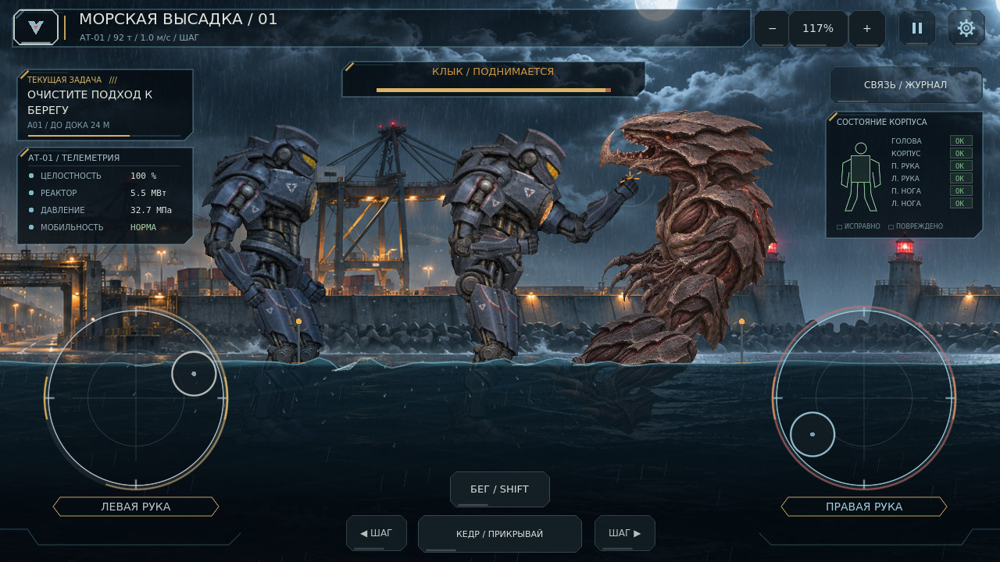
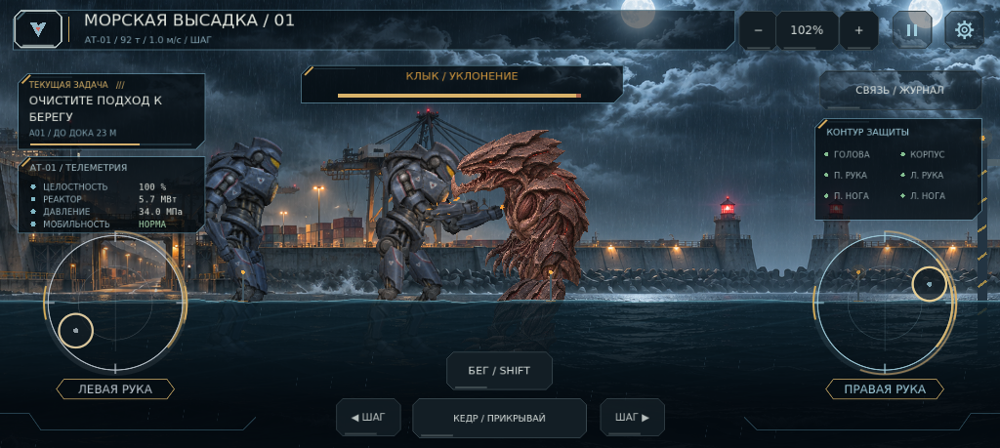

# 0.13.1 — Тяжёлый контакт

Дополнительный проход по ощущению попаданий и читаемости боя. Длительность боя, физика рук, равновесие, бег, карта и схема сохранений 1 сохранены.

## Что изменилось

Камера отвечает на попадание в его направлении, мягко возвращается и ненадолго немного отступает. Случайная мелкая тряска ослаблена. Реальные контакты дают короткую дугу у точки удара и подсвечивают стик попавшей руки. Повторяющиеся контакты одного физического касания не создают бесконечные кольца: максимум восемь эффектов. Глобальное время и обработка управления не замедляются.

В бою выбранный близкий масштаб плавно отступает, чтобы видеть игрока, врага и находящегося рядом Кедра. Вертикальная граница рассчитана по настоящим контурам голов: исправлено перекрытие верхними панелями на близком масштабе. Дальний предел 0.45 сохранён. После боя возвращается ручной масштаб, а процент в HUD показывает фактический текущий зум.

Полоса врага сразу показывает его настоящее здоровье. Короткий затухающий сегмент отмечает только недавнюю потерю, а подпись слегка подсвечивается. При отключении врага обе полосы скрываются. Обратная связь на стике не захватывает пальцы и не меняет управление другой рукой.

Пауза отменяет отдачу и фиксирует положение/масштаб камеры. Режим уменьшенного движения отключает отдачу и автоматический зум, сразу обновляет сегмент здоровья. Подсказки Android в обучении, паузе и настройках используют сенсорные действия; инструкции ПК сохраняют горячие клавиши. Первое обучение объясняет отвод и вынос кулака, оставаясь необязательным.

## Проверка

| Набор Godot 4.7.2 | Пройдено |
|---|---:|
| Кампания, настоящий бой, маршруты и сохранения | 68 |
| Загрузка изображений и отсутствие старых роботов | 33 |
| Пролог, ответы и обучение | 42 |
| Вращение рук, масса, коллизии, вода и пауза | 35 |
| Бег, падения, восстановление, ИИ и минимальная длительность | 25 |
| Кадр, высота голов, отдача, полосы здоровья и независимые пальцы | 22 |

Итого **225 проверок**, неожиданных ошибок скриптов и движка нет. Повторный полный бой настоящими движениями и контактами завершился за **53.7 секунды**. Ограничение разрушения брони из 0.13.0 сохранено: даже предельный поток попаданий требует около 42.25 секунды. Для этого боя прямой вызов урона не использовался.

Новый сценарий кадров зафиксировал настоящие попадания, в том числе силой 1.0, с подсветкой нужной руки и сегментом здоровья. Снимки 1280×720 и 1024×459 просмотрены. Чистая копия без `.godot` заново импортирована: все 22 новые проверки прошли повторно. Android PCK запущен из пустой исходной папки: текстуры, пролог, экспедиция, новая камера и HUD готовы, ошибок нет. Физический Android и APK здесь не тестировались; кадр телефонного размера получен в Linux-версии с программным графическим драйвером.

## Игровые кадры

