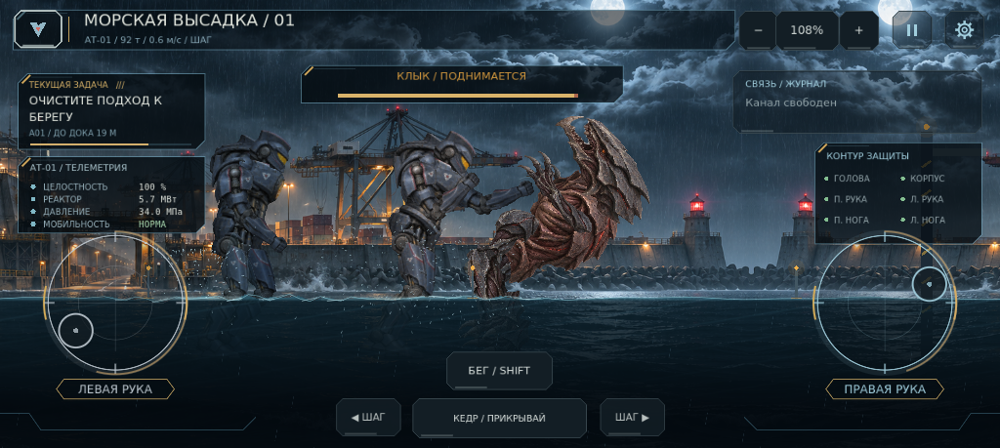
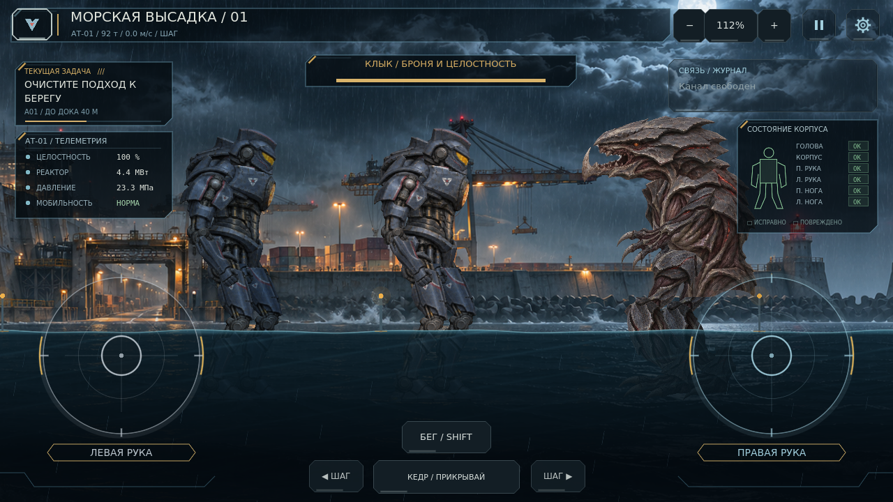
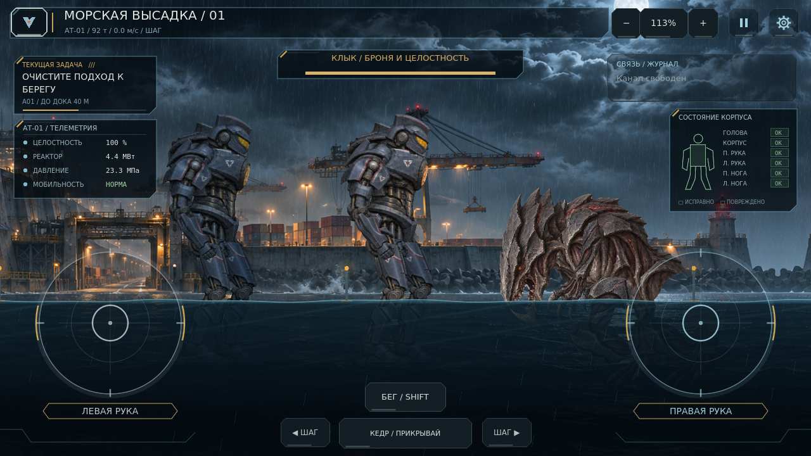
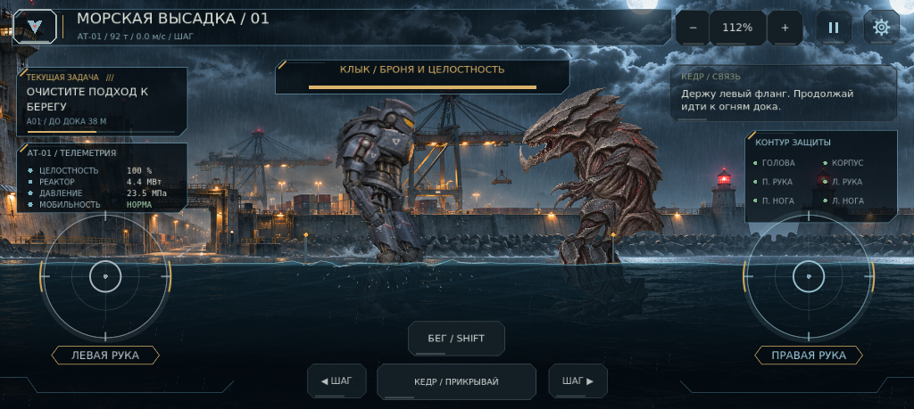
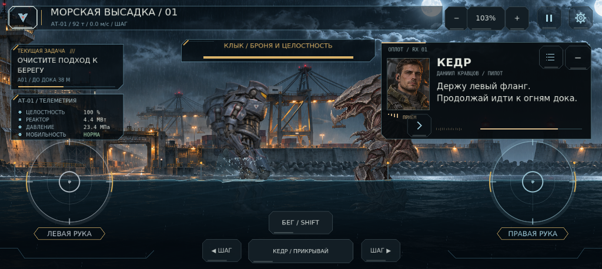

# 0.14.0 — Живая масса

У Клыка теперь настоящий активный рэгдолл. Руки игрока ускорены с сохранением инерции, шаг стал шире, Кедр выведен на задний план, рация стала спокойнее.

## Физика тела

Раньше голова и конечности Клыка были поворачиваемыми формами одного RigidBody2D. Теперь это **10 отдельных физических тел и 9 суставов** общей массой 75 т: корпус, голова, две лапы, два бедра, две голени и две стопы. У каждой детали свой импульс, угловая скорость, масса и измеренный силуэт столкновения; рисунок закреплён на том же теле, что и коллайдер.

Голова соединена с корпусом ограниченной шеей. Удар в корпус ускоряет корпус раньше головы, а настоящий контакт снизу с челюстью поднимает голову за счёт импульса. Желаемый угол головы не меняется при попадании: нет подставной анимации реакции. Мышцы гасят колебание и возвращают стойку. Проверка апперкота получила подъём точки челюсти примерно на **110 пикселей мира** и поворот головы относительно корпуса на **0.66 рад** с сохранением связи суставов.

Плечи, колени и стопы работают физически. Более широкий шаг переставляет настоящие ноги; плеск приходит от контакта стоп с полом. Голова и лапы сохраняют взаимные коллизии; исключены соединённые соседние детали и дальняя/ближняя пара, которые находятся в разных слоях глубины бокового вида. Суставы не накапливают полные обороты.

При потере равновесия мышцы ослабевают, ноги пытаются найти опору; возможны падение и физический подъём. После гибели мышцы отключены, детали продолжают складываться под собственной тяжестью. Свободное падение проверено отдельно с полностью отключёнными приводами. Пауза останавливает все части, а восстановление и сброс стойки согласованно обновляют мировые якоря суставов. При загрузке уже пройденного участка отключены коллизии всех скрытых частей: невидимый враг не перекрывает путь.

## Руки, шаг и передний план

Плечо и локоть быстрее набирают заданную траекторию, с ограниченной скоростью, ускорением и моментом. Возврат после отпускания и ограничители продолжают работать. Проверка измеряет настоящий конец физического предплечья после отвода, затем выноса кулака.

| Измерение одного сценария | 0.13.1 | 0.14.0 |
|---|---:|---:|
| До 80% ударной траектории | 1.53 с | 1.11 с |
| Перемещение в первые 83 мс | 1.17 px | 0.26 px |
| Максимальный вылет стопы при ходьбе | 86.2 px | 110.1 px |
| Ходьба за 5 с | 612.7 px | 697.8 px |
| Бег за 5 с | 900.9 px | 1088.9 px |
| Фаза ног за 5 с ходьбы / бега | 13.71 / 13.08 рад | 12.79 / 11.95 рад |

Это результат одной контрольной траектории, а не обещание одинакового времени любого удара через препятствие. Быстрее заканчивается разгон и вынос, первоначального мгновенного скачка нет. Движение увеличилось при более медленной работе ног.

Вся машина игрока расположена перед всеми частями Кедра. При сближении менее 150 пикселей напарник плавно приглушается; игрок остаётся непрозрачным. Сохраняются отдельная физическая машина напарника, его самостоятельные действия и запрет забрать завершающий удар.

## Рация

Карточка появляется целиком за 0.28 с, с небольшим мягким смещением. Новая страница затухает и раскрывается в одной фиксированной позиции. Срочный вызов даёт предыдущей странице минимум 2.8 с чтения; прерванная передача возвращается к точной странице и времени. Между вызовами — 0.65 с тишины. Завершение компактной реплики тоже затухает, не подменяет текст мгновенно.

В бою автоматически видны только позывной и короткая реплика справа. Полный текст и портрет открываются касанием, журнал сохраняет всю передачу. Свёрнутая карточка не раскрывается снова при очередном сообщении. Диагностика остаётся на постоянном месте. Пауза останавливает переходы; уменьшенное движение убирает смещение и промежуточные затухания.

## Проверка

| Набор Godot 4.7.2 | Пройдено |
|---|---:|
| Кампания, полный физический бой, сеть баз и сохранения | 68 |
| Исходные изображения и отсутствие старых роботов | 33 |
| Пролог, ответы и обучение | 42 |
| Ограничители рук, коллизии, вода, пауза | 35 |
| Бег, равновесие, падения, подъём, ИИ и длительность боя | 25 |
| Кадр, камера, здоровье и независимые пальцы | 22 |
| Настоящий рэгдолл, голова, суставы, шаг и передний план | 24 |
| Спокойная рация и сохранность передач | 21 |
| Темп настоящего кулака и длина шага | 4 |

Итого **274 проверки**, неожиданных ошибок скриптов и движка нет. Повторный полный бой настоящими движениями стиков и контактами завершился за **50.37 с**, у игрока осталось **57.76%** целостности. Без прямых вызовов урона. Предельный расход брони по-прежнему требует около 42.25 с; требование не менее 40 с сохранено.

Чистая копия без кэша импорта заново импортирована. В ней повторно прошли все 82 проверки четырёх наборов: загрузка ресурсов, рэгдолл, рация и темп приводов. Настоящие PNG просмотрены в 1280×720 и 1024×459. В отдельном сценарии зафиксированы пять настоящих контактов со стиков силой до 1.0; диагностические импульсы и отключение мышц подписаны отдельно в JSON-отчёте.

Android PCK экспортирован и запущен из пустой папки без исходного проекта. Проверены новая игра через подпись и инструктаж, высадка, физический риг, самостоятельные тела, компактная рация, плавное завершение вызова, передний план и плоская вода. APK и физический Android здесь не проверялись; телефонные кадры получены в Linux / Mesa llvmpipe.

Схема сохранений 1, регионы II–III в тумане, 11 баз / 17 связей региона I и существующий пролог сохранены. Машиночитаемые результаты: [live_rig_0_14_0.json](verification/live_rig_0_14_0.json).

## Настоящие кадры

